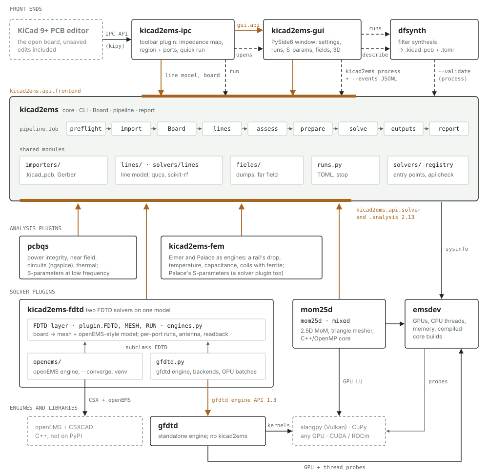

# kicad2ems-project



The whole [kicad2ems](https://github.com/lowprocess/kicad2ems) stack in one checkout: each package is a git
submodule here, at the commit the others were last tested with.

| Repository | What it is |
|---|---|
| [kicad2ems](https://github.com/lowprocess/kicad2ems) | KiCad boards to EM solvers: the board model, the line model, the runs, the reports; `install.py` installs the stack |
| [mom25d](https://github.com/lowprocess/mom25d) | a 2.5D method-of-moments solver (layered Green's functions, GPU LU) |
| [pcbqs](https://github.com/lowprocess/pcbqs) | DC/PDN, MQS/PEEC fields, ngspice circuits on the board's copper and a board's steady temperature; independent of mom25d |
| [gfdtd](https://github.com/lowprocess/gfdtd) | a GPU-accelerated FDTD solver |
| [kicad2ems-fdtd](https://github.com/lowprocess/kicad2ems-fdtd) | kicad2ems's openEMS and gfdtd solver plugins |
| [kicad2ems-fem](https://github.com/lowprocess/kicad2ems-fem) | Elmer and Palace as engines of kicad2ems's study: a rail's drop, temperature, capacitance, coils with ferrite, driven S-parameters |
| [kicad2ems-gui](https://github.com/lowprocess/kicad2ems-gui) | the window: a run's settings, the run and its results |
| [kicad2ems-ipc](https://github.com/lowprocess/kicad2ems-ipc) | the plugin for KiCad's PCB editor (KiCad's IPC API, KiCad 9 and later) |
| [dfsynth](https://github.com/lowprocess/dfsynth) | distributed-element microstrip filter synthesis, checked with kicad2ems |
| [emsdev](https://github.com/lowprocess/emsdev) | the GPUs, CPU and memory as the solvers see them, shared by mom25d and gfdtd |

## Getting it

```bash
git clone --recurse-submodules https://github.com/lowprocess/kicad2ems-project.git
cd kicad2ems-project/kicad2ems
./setup.sh                      # asks what to install; --yes takes the defaults (Windows: py install.py)
```

The installer also makes the example boards, so `kicad2ems examples/demo_transition.toml` runs straight after it.

## Keeping it current

Each submodule tracks its repository's `main` branch:

```bash
git pull --recurse-submodules                   # this repository and the commits it pins
git submodule update --remote --merge           # every package to the latest on its main
git add -A && git commit -m "Submodules: ..."   # pin those commits here
```

Work happens in each package's own repository; this one records which commits go together.

kicad2ems installs the other packages by revision too (its `gui`, `mom`, `qs` and `fem` extras name a commit), so
that `pip install 'kicad2ems[qs]'` gets the stack that was tested together. Those have to be the commits pinned here.
emsdev, which changes seldom and is named by five packages, is pinned by its release tag
(`emsdev/archive/refs/tags/v0.3.0.zip`), the same in all five; `sync_pins.py` checks that and says when emsdev's main
has gone past the tag (tag a release and name it in the five). Not yet pinned: the `openems` and `gfdtd` extras'
kicad2ems-fdtd.

```bash
python sync_pins.py             # each of kicad2ems's pins against its submodule; exit 1 when one is behind
python sync_pins.py --write     # write the submodules' commits into kicad2ems/pyproject.toml
```

When packages change together: commit and push the others, `sync_pins.py --write`, commit and push kicad2ems,
then pin the submodules here.

## Versions

Every package is versioned `MAJOR.MINOR.PATCH` ([semantic versioning](https://semver.org/)), from 0.3.0 on
2026-11-14 (the KiCad plugin keeps its own, 0.1.0, for KiCad's plugin manager). While the stack is at 0.x, MINOR
goes up when what another package relies on changes (a `kicad2ems.api` version, gfdtd's engine API, a file format)
and PATCH for anything else. A package's version goes up when another package needs the change, and a release tags
each repository `vX.Y.Z`. The calendar versions before (`261013-r1` to `261114`) sort above 0.x in pip, so a
floor such as `kicad2ems>=0.3.0` is met by them too; the installer pins commits, so that is only seen by hand.

## Licence

GPL-3.0-or-later (see [LICENSE](LICENSE)), as every package here. mom25d and pcbqs mesh with the `triangle`
package (LGPL-3.0), which compiles in Jonathan Shewchuk's Triangle. Triangle keeps its own terms, which are not
the GPL's: it "may not be sold or included in commercial products without a license" from its author
([Triangle's page](https://www.cs.cmu.edu/~quake/triangle.html)). It is installed as a separate package; none of
its code is in these repositories.
