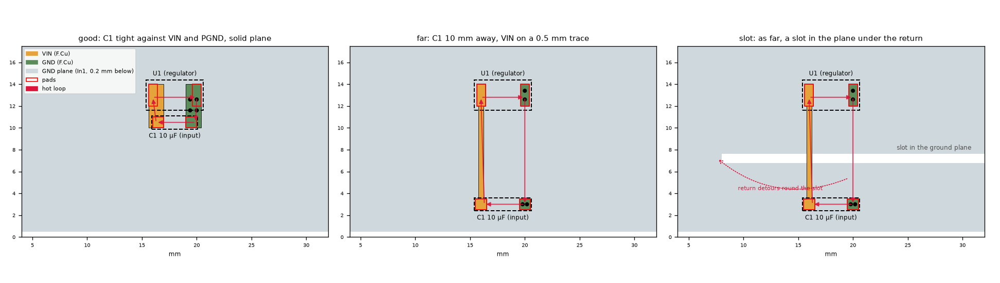
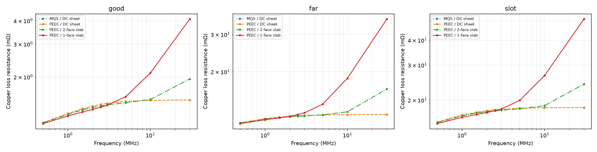
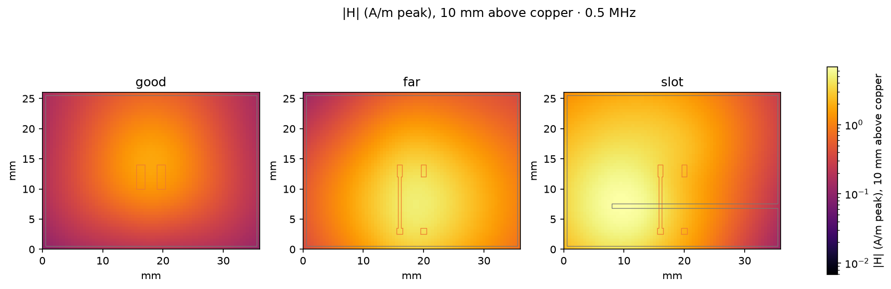
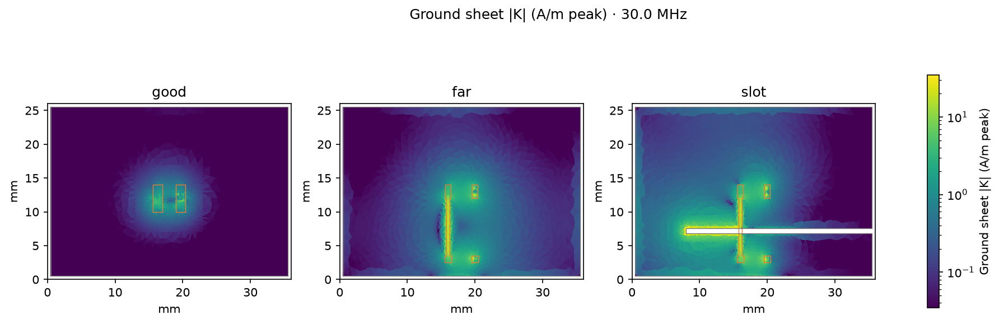
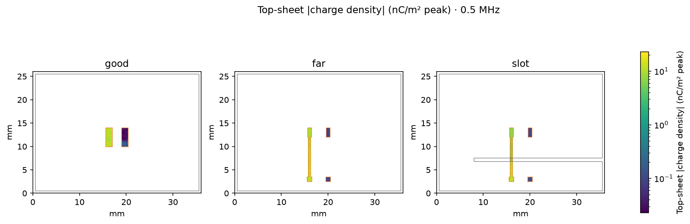
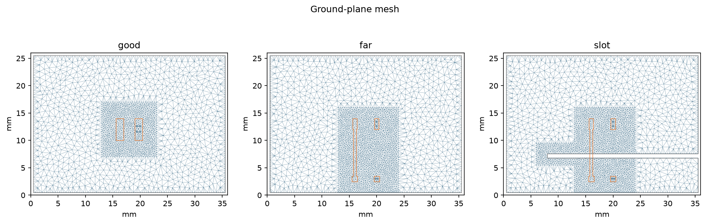

# Three-layout DC-DC input loop: layered PEEC and conductor loss

Re-ran the original good/far/slot layouts at 500 kHz with 3 A input pulses,
33% duty and 5 ns edge smoothing. Harmonics: 1, 2, 3, 4, 5, 6, 10, 20 and 60
(0.5–30 MHz). Board, terminal and local-refinement geometries match the earlier
demo exactly; see `geometry-parity.json`.

## Physics and scope

Distributed copper capacitance uses the original two-slab board: 1.4 mm core
at er=4.5 and 0.2 mm prepreg at er=4.2, each with tanδ=0.02 and air outside.
Copper is 35 µm, σ=5.8e7 S/m. C1 remains 10 µF, 3 mΩ ESR and 0.4 nH ESL.
These are benchmark assumptions, not device measurements.

The frequency-dependent finite-thickness slab includes skin resistance and
internal inductance. In-plane current redistribution and its loss are solved
from the coupled copper network. Through-thickness proximity redistribution
is **not resolved**: the primary result assumes one active face, with a separate
two-face model sensitivity. That comparison is not a rigorous bound or a
validated full proximity-loss solution. Via barrel resistance remains DC.

The selected copper is VIN and GND. This remains a prescribed input-current-loop
model; switch-node voltage/common-mode excitation, package mutual inductance,
output-inductor leakage, retardation and radiation are outside its scope.

## Primary results: PEEC with one-face slab

Resistance is copper dissipation expressed as R=2P/|I_source,peak|², excluding
capacitor ESR and dielectric loss. C is floating VIN–GND board capacitance,
excluding the explicit 10 µF part. H is the 500 kHz harmonic of the original
pulse waveform, spatial peak at 10 mm above the top copper.

| Layout | Board C, pF | Copper R at 500 kHz, mΩ | Copper R at 30 MHz, mΩ | H at 10 mm, A/m peak |
|---|---:|---:|---:|---:|
| good | 1.257 | 1.125 | 4.085 | 1.753 |
| far | 1.762 | 11.383 | 35.462 | 4.810 |
| slot | 1.725 | 15.246 | 51.089 | 6.802 |

Adding capacitance/dielectric loss alone changes the complex port impedance
by at most **0.04155%** across these sampled cases/frequencies.
The layout ranking is preserved; skin/slab assumptions have a much larger
effect on high-frequency copper loss in this input-loop test.

| Layout | Original MQS/DC sheet at 30 MHz, mΩ | PEEC/two-face slab, mΩ | PEEC/one-face slab, mΩ |
|---|---:|---:|---:|
| good | 1.506 | 1.952 | 4.085 |
| far | 12.556 | 16.581 | 35.462 |
| slot | 18.356 | 24.084 | 51.089 |

The slab changes internal inductance as well as resistance, so currents can
redistribute and low-frequency *port-referred* copper loss need not increase
monotonically. Selected-harmonic AC powers in `comparison.csv` exclude DC and
omitted harmonics and are not a prediction of total converter heating.

## Validation and numerical sensitivity

- Analytic PEEC, electrostatic and conductor tests: 24 passed.
- Maximum relative power-balance residual over all models: 6.21e-13.
- Maximum charge-continuity residual relative to displacement current:
  9.25e-08.
- FFT planes meet the 2% successive-grid criterion. Independent direct
  Biot–Savart checks at 75 points per frequency (500 kHz and 30 MHz) differ
  by at most **0.267%**, normalized to the sampled peak at each height.
- Slotted-return refinement from 0.4 to 0.3 mm: 8,573 triangles;
  copper R changes **+0.24%** at 500 kHz
  and **+1.64%** at 30 MHz. Copper energy
  inductance changes -0.40% and
  -0.78%; capacitance changes
  +0.29%. These are sensitivity checks,
  not a demonstrated asymptotic error bound. See `mesh-sensitivity.json`.

## Runtime and reproduction

Intel Core i7-13700K; OpenMP fill with 8 workers, OpenBLAS with 4 threads.
The 108 frequency/model solves, capacitance extractions and field grids took
approximately **498 s**, measured from the original
run log's creation/final-write timestamps (one-second resolution). The original
figure export failed on disconnected ground polygons; the renderer was corrected
and all pictures regenerated from saved solutions with `--plot-only`.
The one-face column includes the
initial shared magnetic/electrostatic assembly; other variants reuse immutable
copper kernels but have independent topology and factors. These timings are
not independent cold-start model benchmarks.

| Layout | PEEC one-face, s | PEEC two-face, s | PEEC DC-sheet, s | MQS DC-sheet, s |
|---|---:|---:|---:|---:|
| good | 43.68 | 26.34 | 25.40 | 2.14 |
| far | 75.38 | 51.73 | 50.21 | 3.88 |
| slot | 83.57 | 57.97 | 56.03 | 4.23 |

```sh
OPENBLAS_NUM_THREADS=4 OMP_NUM_THREADS=8 MPLBACKEND=Agg \
  kicad2ems/.venv/bin/python pcbqs/tools/nearfield_demo.py \
  benchmark-results/dcdc-peec-2026-11-08/full
OPENBLAS_NUM_THREADS=1 kicad2ems/.venv/bin/python \
  benchmark-results/dcdc-peec-2026-11-08/validate_fields.py
OPENBLAS_NUM_THREADS=4 OMP_NUM_THREADS=8 kicad2ems/.venv/bin/python \
  benchmark-results/dcdc-peec-2026-11-08/mesh_sensitivity.py
```

The restored maintained demo is independent of mom25d and kicad2ems; it uses
PCBQS's own numerical and field-export services. Original source/licence
provenance is in `pcbqs/PROVENANCE.json`; module and numerical-function hashes
are in `provenance.json`. Numerical solver implementations were unchanged.

## Pictures and retained results








`full/<layout>/mqs/exc_U1` contains standard complex H dumps for the GUI;
`solution.npz` and `field-planes.npz` retain currents, charges and sampled fields
locally. Per-model JSON files and `comparison.csv` record the measurements.
