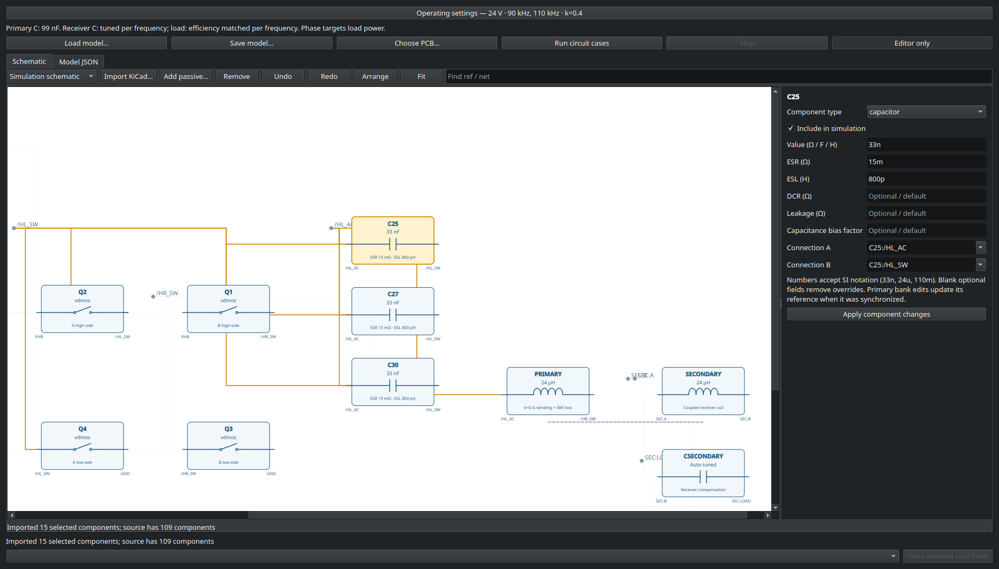
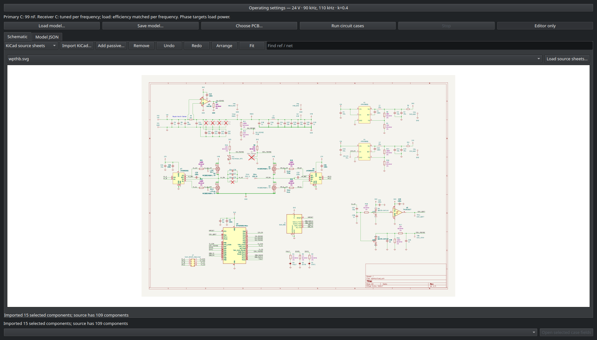
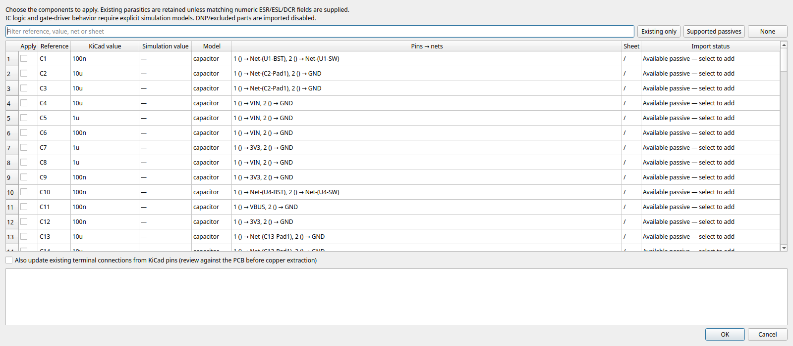

# Simulation schematic editor validation

The Circuit GUI now provides an editable simulation diagram, component inspectors,
named-net highlighting, layout persistence, undo/redo, and reviewed KiCad import.
It configures the existing bridge/WPT workflow. Original KiCad files are read-only;
control-IC logic and unrecognized parts require explicit simulation models.

## WPT design import

- Source: `/home/bt/Desktop/wpthb/wpthb.kicad_sch`.
- Imported 109 components and 69 nets; 15 existing simulation passives selected.
- Original schematic SHA-256 remained
  `bfa98ead23bdd017cef86317d52000bc28e3d5a571b7cf7dae8cba6b36c5f9da`.
- Rendered the original KiCad sheet through temporary CLI exports.
- DNP/excluded parts and unsupported ICs remain visible in source data. Additions
  require explicit selection; absent parasitic fields preserve existing values.

## Electrical execution

Used the actual Qt editor to change C25 to 47 nF with 12 mΩ ESR, producing a
113 nF primary compensation bank; fixed receiver compensation at 100 nF.
Ran the resulting JSON through ngspice at 110 kHz with a 5 W load-power target.

- Accepted after three 32-cycle phase pilots and a 52-cycle transient.
- Delivered 4.97823 W, 0.4354% below target.
- Maximum periodic convergence error: 0.00355388.
- Moving symbols reused the cached case without rewriting its result.

This is an electrical editor-to-solver regression; PCB field extraction was not
rerun for this feature. No solver physics was changed.

## Automated checks

- Backend suite and main GUI regressions: 209 passed (`final-tests.log`).
- Updated parser/editor checks: 36 passed (`editor-final-tests.log`).
- Final GUI lifecycle checks: 11 passed (`gui-lifecycle-tests.log`), including
  QProcess export, cancellation, invalid JSON preservation and stale sheet removal.
- Both package wheels built and contain their new modules (`wheel-build.log`).

## Publication checks

- Final backend/GUI run: 211 passed (`publish-tests.log`).
- Coordinated installer/API checks: 25 passed (`installer-package-tests.log`).
- PCBQS, GUI and kicad2ems versions are `261107.post2`; the core extras pin
  the exact schematic-enabled package commits.
- All three release wheels built. The core wheel was built from a fresh copy of
  the tracked sources because the checkout's old build directory contains
  unwritable files. Dependency revisions were checked in its wheel metadata
  (`core-wheel-clean-build.log`).
- Source commits and wheel hashes are recorded in `release.json`.

## Previews

Raw inputs, outputs, logs and images are retained beside this report.
