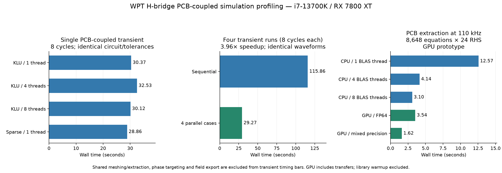

# WPT H-bridge PCB-coupled runtime profile — 7 November 2026

The useful immediate acceleration is **parallel operating points**. Four identical
PCB-coupled eight-cycle runs took **115.86 s sequentially** and
**29.27 s with four workers**: **3.96×** throughput,
with identical exported waveforms. More ngspice device threads did not accelerate
an individual solve. Checked mixed-precision GPU LU is promising for the separate
large PCB extraction stage, not yet an enabled production port-solve backend.



## Workload and method

- Intel Core i7-13700K, 24 logical CPUs; AMD RX 7800 XT, 16 GB; 32 GiB host RAM.
- Installed ngspice 47 with KLU/OpenMP; NumPy/SciPy and CuPy ROCm.
- Original 110 kHz / 30 W case, 24 V, k=0.4, primary 99 nF, receiver tuned;
  phase 90.81656385°. This is the PCB-coupled circuit, not the later
  fixed-100 nF ideal-interconnect experiment.
- Actual copper mesh: 13,528 triangles, 18,245 RWG edges, 267 via segments,
  8,672 loops, 24 ports. Circuit copper equivalent has 66 retained modal states.
- Frozen accepted netlist, unchanged component models, parasitics, Gear method,
  tolerances, maximum timestep and initial conditions. Only thread count, sparse
  solver selection, output instrumentation or stop time changed between tests.
- Eight-cycle runs isolate timing efficiently; they are not claims of a settled
  operating point. A separate full 52-cycle rerun validates the original accepted
  simulation. Batch comparisons use four copies of exactly the same workload.
- Circuit bars exclude shared extraction, phase targeting and field reconstruction.
  Numbers are measured runs, not statistical averages. Hardware scheduling/clock
  variation limits interpretation of small differences.
- CPU profiling uses ngspice's internal `rusage all`, wall/CPU time and peak RSS.
  Kernel policy prevented `perf record` sampling; no system policy was changed.

## Full 52-cycle regression

The accepted circuit reran in **191.82 s**, using
190.93 s user CPU time and
1.30 GiB peak host RSS.
It delivered **29.9124 W**, primary **2.21117 A RMS**, input **31.8367 W**.
Primary/secondary currents, load and bus voltage, all 24 PCB port currents, and
exported timestamps exactly matched the saved original `transient.npz`.

| Internal work | Seconds | Analysis share |
|---|---:|---:|
| Matrix factorization | 155.201 | 81.4% |
| Device/matrix loading | 20.366 | 10.7% |
| Triangular solve | 10.328 | 5.4% |
| Remaining analysis | 4.778 | 2.5% |

Output work after the solve was 1.093 s, below 1% of total wall time.
There were 371 equations, 1,903,515 Newton
iterations, 546,430 accepted steps and
211,258 rejected steps (27.9% of
attempts). A faster individual transient needs fewer/cheaper repeated
factorizations or fewer steps/iterations; Python plotting is not the bottleneck.

## ngspice thread and solver comparison

| Eight-cycle run | Wall seconds |
|---|---:|
| KLU, 1 device thread | 30.37 |
| KLU, 4 device threads | 32.53 |
| KLU, 8 device threads | 30.12 |
| Sparse 1.3, 1 device thread | 28.86 |
| KLU, no output processing | 29.13 |

The 1/4/8-thread KLU runs exported identical waveforms and measurements, and
used approximately one core. The small Sparse-versus-KLU difference is not enough
to justify changing the default on this evidence. Sparse differed from KLU by
less than 0.006% of peak in primary/secondary current and load/bus voltage.
Output-disabled wall differences
include clock/scheduling variation; internal before/after-output timing directly
shows the output cost is small.

ngspice OpenMP parallelizes selected compact transistor model evaluation, not the
KLU factorization. The present smooth-switch/level-1 circuit does not exercise
those parallel device models. See the official
[ngspice manual, multicore/OpenMP section](https://ngspice.sourceforge.io/docs/ngspice-manual.pdf).
The installed ngspice executable uses CPU sparse solvers. The documented legacy
[CUSPICE CUDA experiment](https://ngspice.sourceforge.io/download.html) is based
on ngspice 27 and NVIDIA CUDA; it does not provide a supported AMD GPU transient
backend for this workflow.

## Actual PCB extraction matrix: CPU versus GPU

The matrix was assembled from this board at **110 kHz**, including slab conductor
loss: **8,648 × 8,648 complex128**, with **24 right-hand sides**. This is the real
loop-port extraction system, not a random dense matrix. Mesh construction took
0.20 s and shared matrix assembly 21.84 s.

| Solve implementation | Seconds |
|---|---:|
| CPU symmetric complex128, 1 BLAS thread | 12.570 |
| CPU symmetric complex128, 4 BLAS threads | 4.144 |
| CPU symmetric complex128, 8 BLAS threads | 3.102 |
| GPU complex128, transfers included | 3.540 |
| GPU complex64 LU + complex128 refinement, transfers included | 1.618 |

GPU library warmup (1.23 s) is excluded; cold-start
latency must be added once. Mixed LU factorization took
0.514 s and solve/residual/refinement work
1.056 s. Relative RHS residual improved through
`6.90e-7 → 6.59e-11 → 1.27e-14`. Relative port-impedance difference from the CPU
was **1.84e-13**. Relative full solution
difference was 9.92e-12.

The mixed GPU solve was **1.92×** faster than
the best measured CPU solve, and about 7.8× faster than one BLAS thread. GPU FP64
alone was slightly slower than the best CPU run. These gains apply to this
frequency's extraction solve, not the complete transient or complete extraction
sweep. Assembly and fitting are unaffected. The GPU refinement prototype needs
frequency/conditioning coverage, checked residuals, failure fallback and a clear
backend option before production integration.

## Changes made

- CLI `--jobs N`; GUI **Parallel circuit cases**, default four capped by CPU count.
  Shared PCB work occurs before worker children. Requested result order is kept.
- All active ngspice children are terminated when a sweep stops or fails; queued
  cases are cancelled. Both unit checks and a real CLI SIGTERM run verified no
  surviving children.
- Per-transient `performance.json`, per-trial statistics and total case `runtime_s`.
- Field responses are prefetched, then dense extraction matrices are released
  before circuit workers. Circuit-only runs release the extraction object.
  Geometry and cached current transfers remain available for field reconstruction.
- No package/module split, moved files, GPU default change, or physics/tolerance
  relaxation was made. All changes remain uncommitted.

Validation: 20 circuit/backend tests and 3 Circuit GUI tests passed. Two real CLI
operating points completed with `--jobs 2`: 5 W target gave 4.98021 W, 10 W gave
9.98063 W, both within the configured power/settling criteria. This CLI smoke run
used ideal interconnects; the frozen-netlist timing/regression runs above used the
full PCB copper equivalent.

## Next useful work

1. Use independent cases concurrently now; benchmark longer sweeps within available
   memory. The 3.96× result was the four-run eight-cycle timing batch, not a claim
   of a measured four-case 52-cycle batch.
2. Investigate the 27.9% step rejection rate and modal-network conditioning. Keep
   power, copper-current spectra and timestep-convergence checks; do not gain time
   by silently removing fast parasitic physics.
3. Prototype a smaller linear copper companion/state-space implementation or reuse
   the linear block during Newton updates. The factorization-dominated profile
   supports this direction; performance/accuracy are not yet established.
4. Integrate the checked mixed GPU extraction solve as an explicit optional backend
   after DC, high-frequency and ill-conditioned-port validation. Avoid automatic
   selection based solely on this one-frequency result.
5. Agree an ownership/dependency boundary before moving QS/circuit modules. See
   [architecture notes](architecture-notes.md). The user asked to hold off on splitting.

## Artifacts and reproduction

- `summary.json`: all timing/accuracy data; `runtime-comparison.png`: plot.
- `full52-klu-t1/`: accepted frozen netlist, log, data and full regression timing.
- `batch.json`, `batch-j*/`: four-run sequential/parallel comparison and waveforms.
- `ports.json`, `profile_ports.py`: actual matrix solve and checked GPU prototype.
- `cli-smoke/`: real two-point execution through the updated orchestrator.
- `cancellation.json`, `check_cancel.py`: real CLI stop check.

From the project root, using its virtual environment:

```sh
kicad2ems/.venv/bin/python benchmark-results/wpthb-profile-2026-11-07/profile.py --name repeat --cycles 8 --threads 1
OPENBLAS_NUM_THREADS=1 kicad2ems/.venv/bin/python benchmark-results/wpthb-profile-2026-11-07/profile_batch.py
OPENBLAS_NUM_THREADS=1 kicad2ems/.venv/bin/python benchmark-results/wpthb-profile-2026-11-07/profile_ports.py
```

The extraction benchmark needs sufficient host/GPU memory and the installed
ROCm-compatible CuPy wheel. Scripts use isolated output directories and preserve
the original PCB and accepted result files.
