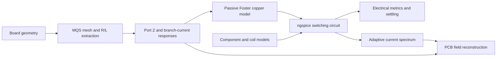

# QS/circuit ownership assessment — no split performed

This is a dependency assessment for discussion, not an implemented migration.
The user asked to hold off on splitting. Existing packages, module paths and CLI
entry points remain in place.

## Current ownership

`kicad2ems` owns the board schema/imports, solver-run interfaces and result formats.
`mom25d` currently contains both its full-wave MoM solver and the QS/PEEC/circuit
workflow. `kicad2ems-gui` runs QS/circuit CLIs as subprocesses and displays their
mesh, layout, waveforms and field files. PDN and operational circuit analysis are
separate workflows with shared board/mesh infrastructure.

The circuit workflow is:

Copper enters the circuit through an approximate passive broadband equivalent;
periodic copper fields are inferred afterwards from the original MQS responses.
External coil/cable/environment geometry is not part of that field model.

## Confirmed consumers outside the QS workflow

The table follows imports/calls in the current production source. Test usage is
not counted as a separate production consumer.

| Code | Outside-QS consumer | Ownership implication |
|---|---|---|
| `base.py`: RWG basis, quadrature, matrix projection | `sim.py`, `fast.py`, `farfield.py`, `sing.py`, others | Shared numerical foundation; retain one owner. |
| `geo.py`: polygon triangulation | Full-wave geometry and `pdn/mesh.py` | Shared meshing. |
| `pdn/mesh.py`: copper selection, sheet meshing, stack elevations | `pdn/dc.py`, `pdn/cavity.py`, `pdn/stack.py` | Shared with power integrity. |
| `pdn/rail.py`: part/terminal interpretation | PDN CLI/network assembly | Shared board/component interpretation. |
| `biot.py`: `rwg_currents`, `_split4` | `farfield.py` and `sing.py` (subdivision) | These helpers are shared; moving the whole module would create a reverse dependency. |
| `farfield.py`: `current_deposit` | Full-wave field processing; also used by QS FFT H | Another shared dependency, beyond meshing. |
| Compiled `_core` numerical extension | Full-wave kernels and QS static fill | Mixed ownership within one extension/build. |
| `static.py`, `static_backends.py`, `static_cupy*.py` | No outside-QS production consumer found | Static fill implementation is QS-specific today. |
| `electrostatic.py` | No outside-PEEC production consumer found | PEEC-specific today. |
| `conductor.py`: slab surface impedance | No outside-MQS production consumer found | QS-specific today; full-wave conductor loss uses other code. |
| Most of `biot.py`: sheet/filament H, FFT H | No outside-QS production caller found | QS-specific around its shared helper functions. |
| `mqs.py`, `peec.py`, `mqs_ports.py` | QS/circuit workflow | Solver/reduction layer specific to this workflow. |
| `power_*.py`, `wpt.py`, model JSON | Operational circuit workflow | Circuit orchestration, ngspice adapter and example models. |

## Decisions to settle before a move

1. Decide whether a new package owns the whole QS solver or just circuit coupling.
   Moving only ngspice orchestration is smaller, but leaves the solver/reduction
   boundary inside `mom25d`.
2. Define a stable geometry/mesh/current-response contract, rather than exposing
   private `MQS._assemble()` dictionaries as the long-term inter-package API.
3. Decide where shared basis/current-deposition helpers and compiled kernels live.
   An adapter to `mom25d` is a viable first step; it is still a real dependency.
   A separate shared numerical package is a larger change requiring build/install
   and full-wave regression work.
4. Keep generic circuit building/solver execution separate from the WPT-specific
   topology, phase controller and coil assumptions.
5. Establish port ordering, signs/units, passivity/error metadata, caching/version
   rules, cancellation, hardware selection and result-file compatibility at the
   boundary. Preserve old imports/CLI entry points during any eventual migration.

No new package name, repository, dependency reversal or installer change has been
chosen. Profiling supports distinct interfaces for (a) static fill/extraction,
(b) circuit execution and (c) field reconstruction; it does not by itself decide
which repository should own their shared primitives.
